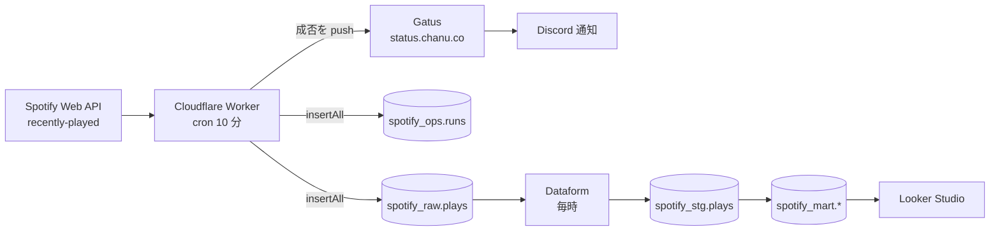

# spotify-play-history の設計

## 目的

Spotify の再生履歴を取りこぼさずに貯め、Looker Studio で眺める。

recently-played API は直近 50 曲しか返さず、過去にさかのぼって取り直せない。取得が止まった期間はそのまま欠けるので、止まったらすぐ気づけることを、取得そのものと同じくらい重く見る。

## 全体

| 層 | 置き場所 | 持ち主 |
|---|---|---|
| 取得 | Cloudflare Worker `spotify-play-history`（`worker/`） | この repo |
| データ | GCP プロジェクト `chanuco` の BigQuery（asia-northeast1） | dataset・表・権限はこの repo（`infra/`）。プロジェクト・API・SA は ochanuco/chabatake |
| 変換 | Dataform の repository `spotify-play-history`（repo の root の `workflow_settings.yaml` と `definitions/`） | この repo |
| 監視 | Gatus の external endpoint `spotify_play-history` | ochanuco/chabatake |

Cloud Scheduler は使わない。取得の起動は Worker の cron、変換の起動は Dataform 自身の schedule が持つ。

## 取得（Worker）

10 分ごとに次を行う。

1. refresh token で access token を取る。Spotify が新しい refresh token を返したら KV に保存し、次からそれを使う。古い token は使えなくなる
2. KV のカーソル（取り込んだ最新の `played_at`）の 2 分前を `after` にして、recently-played を 50 件まで取る。初回は `after` なしで直近 50 件
3. item を丸ごと JSON で `spotify_raw.plays` に insertAll する。同じ再生が何度入ってもよい
4. カーソルを進める
5. 実行の結果を `spotify_ops.runs` に書き、成否を Gatus に push する

refresh token の扱い:

- secret `SPOTIFY_REFRESH_TOKEN` は最初の 1 本
- KV には「どの secret から始まった系列か」（secret のハッシュ）と一緒に、最新の token を持つ
- secret を取り直して入れ替えると系列が変わるので、KV の古い token ではなく secret を使う

BigQuery へは SA `spotify-play-history-ingest` の鍵で書く。Workers は Workload Identity Federation に使える ID トークンを出せないため。鍵の権限は `spotify_raw.plays` と `spotify_ops.runs` の 2 つの表への書き込みだけ。

## データ

| 表 | 種類 | 中身 |
|---|---|---|
| `spotify_raw.plays` | 表（`fetched_at` で日分割） | `played_at`、`track_id`、`item`（API の item の JSON）、`fetched_at`、`run_id`。重複あり |
| `spotify_ops.runs` | 表（`started_at` で日分割） | 実行ごとの `status`（ok / error）、`after_played_at`、`fetched`、`error` |
| `spotify_ops.ingest_daily` | view | 日ごとの実行回数・失敗回数・最後のエラー |
| `spotify_stg.plays` | incremental | 1 再生 1 行。`(played_at, track_uri)` で重複を除き、曲・アーティスト・アルバム・コンテキストを列にする |
| `spotify_mart.plays` | view | Looker Studio 向けの一覧。日時は JST。聴いた時間（`listened_ms_estimate`）とスキップ（`skipped_estimate`）の推定を持つ |
| `spotify_mart.daily_listening` | 表 | JST の日ごとの再生数・分数・曲数・アーティスト数 |
| `spotify_mart.listening_by_hour` | view | 直近 90 日の曜日 × 時間帯 |
| `spotify_mart.top_artists_monthly` | 表 | 月ごとのアーティスト別再生数と順位 |

raw に item を丸ごと残すのは、取り直せないデータから後で別の列を作れるようにするため。列を足すときは stg の SQL を変えて、Dataform を full refresh で流し直す。

聴いた時間とスキップの推定: recently-played はどれだけ聴いたかを返さない。`played_at` は再生を終えた時刻なので、続けて聴いている間は前の再生との間隔が聴いた時間になる。間隔が曲の長さの 9 割未満ならスキップとみなす。間隔が曲の長さを 1 割以上超えたときは間に休みがあったとみなし、どちらも null にする。すぐに飛ばした曲は recently-played に載らないことがあるので、スキップの数は少なめに出る。

重複の除き方: ローカルファイルの再生は `track_id` が null なので、`track_uri` を使って見分ける。`stg.plays` の assertion（`spotify_ops` に作る）が、キーの重複と null を検査する。

## 変換（Dataform）

- release config `main` が毎時 50 分に `main` ブランチを compile し、workflow config `hourly` が毎時 0 分に実行する（JST）
- 実行は SA `spotify-play-history-dataform`。読むのは raw と ops、書くのは stg・mart・ops
- Dataform は repo のサブディレクトリを root にできないので、`workflow_settings.yaml` と `definitions/` は repo の root に置く

## 監視

Worker は毎回、成否を Gatus の external endpoint `spotify_play-history` に push する。push の口は Cloudflare Access が service token を持つ Worker にだけ開けている。

- push が 30 分届かないことも失敗として数える（Worker が動いていない、鍵や Access の token が切れたなど）
- 失敗が 3 回続くと Discord に知らせる。直るまで 6 時間ごとに知らせ直し、直ったら知らせる
- 止まっていても、取りこぼすのは 50 曲を超えて聴いてから。通知が届くまでの遅れは、その範囲に収まる

エラーの中身は `spotify_ops.runs` と Gatus の画面、Worker のログで見る。Dataform の失敗は監視していない。raw は残るので、直してから流し直せば追いつく。

## 秘密

1Password の `gh-deploy/spotify-play-history` に置き、deploy workflow が Worker の secret として反映する。Dataform が GitHub を読む token は、Dataform が読む Secret Manager の `spotify-play-history-dataform-git-token` に置き、控えを 1Password の同じ item に置く。
